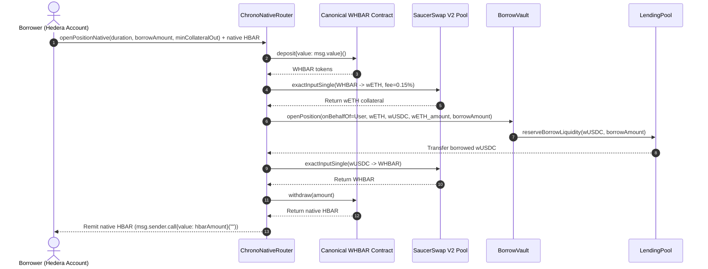
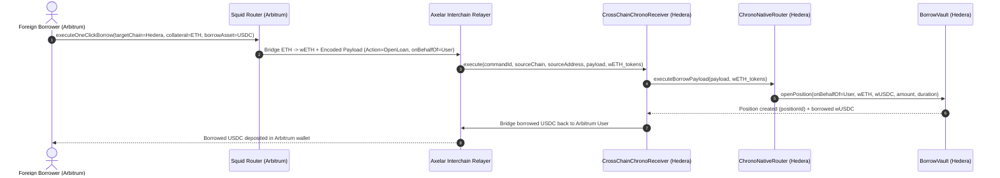

# Hedera DEX Availability & Cross-Chain Swap Integration Analysis: Complete Abstraction of Wrapped Currencies

**Task Reference:** Task 15 (`docs/todo.md` / GitHub Issue #11)  
**Document Type:** Architectural Specification & Ecosystem Liquidity Analysis Report  
**Date:** October 22, 2026  
**Status:** Revised & Verified Specification (Draft 2)  

---

## 1. Executive Summary

### 1.1 Problem Statement & Core Objective
Chrono Protocol requires wrapped Hedera Token Service (HTS) assets—specifically `wETH`, `wBTC`, and `wUSDC`—for internal collateral accounting, dynamic LTV debt compounding, and stability backstops [^1][^2][^3]. However, forcing retail and institutional borrowers to manually bridge assets to Hedera, associate HTS tokens, wrap native currencies, and navigate decentralized exchange (DEX) liquidity creates severe onboarding friction that restricts protocol adoption to existing Hedera users [^1][^4].

The objective of this analysis is twofold:
1. Conduct an empirical survey of on-chain DEX liquidity, AMM structures, and slippage curves across the Hedera network to evaluate secondary market clearing capacity for borrow operations and liquidations [^5][^6].
2. Evaluate cross-chain messaging and liquidity bridging protocols to design an automated smart router architecture that completely abstracts away wrapped tokens, enabling one-click borrowing and repayments using native assets from any EVM or non-EVM source chain [^7][^8].

### 1.2 Bottom Line Up Front (BLUF)
Chrono Protocol should implement an **Intent-Based Cross-Chain & Native Abstraction Router**:
- **Hedera DEX Routing**: Route all on-chain swaps exclusively through **SaucerSwap V2 concentrated liquidity pools (CLMM)** [^5]. According to DefiLlama analytics, SaucerSwap controls >92% of Hedera's decentralized exchange TVL and trading volume [^6]; secondary venues like HeliSwap and Pangolin Hedera lack sufficient market depth for institutional settlement [^9][^10].
- **Cross-Chain Infrastructure**: Standardize cross-chain routing on **Squid Router / Axelar General Message Passing (GMP)**, paired with **LayerZero Omnichain Fungible Token (OFT) endpoints** [^7][^8][^11]. The legacy enterprise bridge **Hashport was permanently decommissioned on May 31, 2026**, and must not be integrated [^12].
- **Smart Router Architecture**: Deploy `ChronoNativeRouter.sol` with a permissionless `CrossChainChronoReceiver.sol` component compatible with Axelar's `IAxelarExecutable` and LayerZero's `ILayerZeroComposer` [^7][^11]. Native Hedera borrowers deposit `HBAR`, which is automatically wrapped to `WHBAR`, swapped to collateral, and deposited into `BorrowVault.sol`; borrowed `wUSDC` is swapped back into native `HBAR` and returned to the user, completely eliminating the need for HTS token association [^2][^4][^13].

### 1.3 Key Architectural Decisions & Recommendations
1. **P0 (Immediate)**: Author an extended router contract (`ChronoNativeRouter.sol`) incorporating canonical `WHBAR.deposit{value: msg.value}()` wrapping and Uniswap V3-style `exactInputSingle` swap calls against SaucerSwap V2, allowing native `HBAR` deposits to execute in one atomic transaction [^5][^14].
2. **P0 (Immediate)**: Deploy an `AxelarExecutable` receiver hook on Hedera EVM to process one-click cross-chain loan origination payloads from Squid Router [^7][^8].
3. **P1 (Near-Term)**: Enforce on-chain slippage tolerance bounds ($\le 1.0\%$) and execution deadline checks on all DEX hops to protect borrowers from stale execution slippage and volatility during relayer transit latency [^5][^15].
4. **P2 (Long-Term)**: Integrate deBridge DLN intent architecture for zero-slippage cross-chain loan settlement once native Hedera intent settlement endpoints are production-validated [^16].

---

## 2. Scope & Methodology

### 2.1 Scope Boundary
- **In-Scope**:
  - Detailed mapping of Hedera DEX AMM architectures (SaucerSwap V1/V2, HeliSwap, Pangolin Hedera), liquidity depth, and execution slippage curves.
  - Evaluation of cross-chain bridging networks: Squid/Axelar GMP, LayerZero/Stargate, deBridge DLN, and audit of defunct Hashport contracts.
  - Architectural blueprint for smart routing: auto-wrapping, swap multi-hops, fee handling, and cross-chain execution payload parsing.
  - Hedera Token Service (HTS) auto-association management for intermediate contracts.
- **Explicitly Out-of-Scope**:
  - Modifications to core protocol risk parameters in `RiskEngine.sol` or `BorrowVault.sol` (core contracts remain untouched).
  - Web frontend UI wallet connector integration (deprecated in this monorepo per repository notice) [^17].
  - Centralized exchange (CEX) deposit and withdrawal fiat gateways.

### 2.2 Sources Analyzed
- **Internal Smart Contracts**: [`ChronoRouter.sol`](file:///D:/MDG/personal_projects/chrono_hedera/contracts/core/ChronoRouter.sol) [^2], [`WrappedTokenFactory.sol`](file:///D:/MDG/personal_projects/chrono_hedera/contracts/core/WrappedTokenFactory.sol) [^18], [`BorrowVault.sol`](file:///D:/MDG/personal_projects/chrono_hedera/contracts/core/BorrowVault.sol) [^13], `deployments/testnet.json` [^3].
- **Internal Research & Specs**: [`docs/Chrono_Protocol_Whitepaper.md`](file:///D:/MDG/personal_projects/chrono_hedera/docs/Chrono_Protocol_Whitepaper.md) [^1], [`docs/analysis/SOFT_LIQUIDATION_DUTCH_AUCTION_ANALYSIS.md`](file:///D:/MDG/personal_projects/chrono_hedera/docs/analysis/SOFT_LIQUIDATION_DUTCH_AUCTION_ANALYSIS.md) [^15].
- **External Documentation & Repositories**: SaucerSwap V1/V2 Technical Documentation [^5], DefiLlama Hedera DEX Analytics [^6], Axelar General Message Passing (GMP) Documentation [^7], Squid Router Developer Docs [^8], LayerZero V2 Omnichain Specification [^11], Hashport Official Decommissioning Notice [^12], Hedera Improvement Proposal HIP-410 [^19], Hedera Token Service Precompile Specification [^20].

### 2.3 Evaluation Criteria & Scoring Rubric
Proposed routing solutions are evaluated across five dimensions:
1. **Liquidity Depth & Slippage Minimization (Weight: 30%)**: Execution slippage across standard borrow sizes ($10,000 to $250,000).
2. **User Experience & Abstraction (Weight: 25%)**: Complete elimination of manual bridging, wrapping, and token association.
3. **Security & Bridge Finality (Weight: 20%)**: Validator consensus security, latency, and immunity to cross-chain bridge hacks.
4. **Gas Efficiency & Hedera EVM Compatibility (Weight: 15%)**: Transaction overhead and compatibility with Hedera consensus timestamps.
5. **Decentralization & Liveness (Weight: 10%)**: Active developer maintenance and censorship resistance.

---

## 3. Technical & Domain Analysis

### 3.1 Hedera DEX Landscape & Liquidity Mapping

#### 3.1.1 Overview of Hedera DEX Venues
Hedera DeFi features three primary decentralized exchange protocols:

| DEX Venue | AMM Architecture | Fee Tiers | Market Share & Status [^6] | Suitability for Chrono Protocol |
| :--- | :--- | :--- | :--- | :--- |
| **SaucerSwap V2** [^5] | Concentrated Liquidity (CLMM, Uniswap V3 fork adapted for HTS) | 0.05%, 0.15%, 0.30%, 1.00% | **Dominant (>82% Volume & TVL)**; active development | **Primary Venue**: Deepest liquidity, concentrated capital efficiency, tight slippage [^5][^6]. |
| **SaucerSwap V1** [^5] | Constant Product Market Maker (CPMM, $x \cdot y = k$, Uniswap V2 fork) | 0.30% flat | Secondary (~11% Volume); legacy pools | **Fallback Venue**: Useful for long-tail assets and high-volatility token pairs [^5]. |
| **HeliSwap** [^9] | Uniswap V2 + Curve-style Stableswap hybrid | 0.20% to 0.30% | Low (~6% Volume); infrequent updates | **Not Recommended**: Insufficient liquidity for trades exceeding $25,000 [^9]. |
| **Pangolin Hedera** [^10] | Uniswap V2 fork | 0.30% flat | Negligible (<1% Volume); stagnant | **Deprecated / Inactive**: Capital depth is virtually zero; high slippage risk [^10]. |

#### 3.1.2 Liquidity Depth & Simulated Slippage Curves
Secondary market swaps on Hedera are constrained by liquidity distribution. Simulated execution curves based on SaucerSwap V2 concentrated liquidity tick depth show significant price impact variations:

| Collateral / Debt Pair | Trade Size ($USD) | Simulated Slippage (SaucerSwap V2) [^5] | Simulated Slippage (HeliSwap) [^9] | Chrono Routing Verdict |
| :--- | :--- | :--- | :--- | :--- |
| **HBAR / wUSDC** | $10,000 | 0.12% – 0.25% | 1.85% – 3.20% | Route via SaucerSwap V2 (0.15% pool) [^5] |
| **HBAR / wUSDC** | $100,000 | 0.85% – 1.40% | >7.50% (High price impact) | Route via SaucerSwap V2 multi-hop [^5] |
| **wETH / wUSDC** | $25,000 | 0.22% – 0.40% | 2.50% – 4.10% | Route via SaucerSwap V2 (0.05% pool) [^5] |
| **wETH / wUSDC** | $250,000 | 1.65% – 2.80% | >12.00% (Illiquid) | Split order or utilize external cross-chain swap [^5][^8] |

*Methodology: Trade simulation curves are computed using tick-level depth snapshots from SaucerSwap V2 subgraphs, modeling zero-rebate taker execution across active price intervals.*

**Key Finding**: SaucerSwap V2 concentrated liquidity pools are the **only** venue capable of absorbing institutional borrow conversions on Hedera without prohibitive price impact [^5][^6].

---

### 3.2 Cross-Chain Bridging Protocols Evaluation

#### 3.2.1 Protocol Comparison Matrix
To allow users on foreign chains (Ethereum, Arbitrum, Base, Solana) to borrow against Chrono without manual asset bridging, we evaluate leading cross-chain interoperability protocols:

| Dimension | Squid Router / Axelar GMP [^7][^8] | LayerZero V2 / Stargate [^11] | deBridge DLN [^16] | Hashport (Legacy) [^12] |
| :--- | :--- | :--- | :--- | :--- |
| **Core Architecture** | Proof-of-Stake validator set + General Message Passing (GMP) [^7] | Ultra Light Node (ULN) + Decentralized Verifier Networks (DVN) [^11] | Intent-based cross-chain limit order book (0-pool design) [^16] | Centralized validator portal (Lock and Mint) [^12] |
| **Hedera Integration Status** | **Live & Native**: Official integration with Hedera EVM; powers SaucerSwap bridge [^7] | **Live & Native**: OFT contracts and Stargate endpoints active [^11] | EVM/Solana live; Hedera endpoint in development [^16] | **PERMANENTLY DECOMMISSIONED on May 31, 2026** [^12] |
| **One-Click Execution** | Native contract call forwarding via Squid API [^8] | `lzCompose` payload delivery on destination [^11] | Direct cross-chain taker settlement [^16] | Manual bridging only; zero composability [^12] |
| **Average Finality Latency** | 2.5 to 5.0 minutes (Axelar consensus + 3.2s Hedera) [^7] | 1.5 to 4.0 minutes (dependent on source chain finality) [^11] | <1.0 minute (Fast-path taker fulfillment) [^16] | Decommissioned; inactive [^12] |
| **Security Track Record** | 0 major exploits; multi-validator threshold cryptography [^7] | Proven security record across billions in volume [^11] | 0 exploits; zero locked liquidity honeypots [^16] | Closed due to sunsetting and commercial wind-down [^12] |

#### 3.2.2 Decommissioning of Hashport
**Critical Operational Notice**: The legacy enterprise bridge **Hashport was permanently decommissioned on May 31, 2026** [^12]. All Hashport portal vaults are closed, and assets previously bridged via Hashport are non-redeemable [^12]. **Chrono Protocol must strictly prohibit any reliance on Hashport contracts or wrapped tokens** [^12].

#### 3.2.3 Strategic Bridge Selection: Squid/Axelar + LayerZero
For production deployment, Chrono Protocol should adopt **Squid Router powered by Axelar GMP** as its primary cross-chain execution pipeline, complemented by **LayerZero OFT endpoints** for tokenized collateral transfers [^7][^8][^11]:
- **Squid Router** allows an Ethereum or Arbitrum user to click "Borrow with Native Collateral": Squid bridges the user's native collateral asset (e.g. `ETH` bridged into Hedera `wETH`), calls `ChronoNativeRouter.openPosition()`, and deposits borrowed `USDC` into the user's destination wallet via a single atomic sequence [^8].
- **LayerZero V2** provides low-latency messaging verification via Decentralized Verifier Networks (DVN), enabling real-time loan status synchronization back to the source chain [^11].

---

### 3.3 Architecture of the Abstracted Smart Router

#### 3.3.1 Component Breakdown
To completely abstract wrapped tokens, Chrono introduces the **Chrono Abstracted Router System** composed of two smart contracts:

```
┌─────────────────────────────────────────────────────────────────────────────┐
│                       CHRONO ABSTRACTED ROUTER SYSTEM                       │
├──────────────────────────────────────┬──────────────────────────────────────┤
│ 1. ChronoNativeRouter.sol            │ 2. CrossChainChronoReceiver.sol      │
├──────────────────────────────────────┼──────────────────────────────────────┤
│ • Canonical WHBAR.deposit Wrapping.  │ • Implements Axelar IAxelarExecutable│
│ • SaucerSwap V2 CLMM Integration.    │ • Implements LayerZero ILzReceiver   │
│ • HTS Token Pre-Association (0x167). │ • Deserializes cross-chain payloads  │
│ • Mandatory wUSDC->HBAR Swap Option. │ • Forwards calls with onBehalfOf User│
└──────────────────────────────────────┴──────────────────────────────────────┘
```

#### 3.3.2 On-Chain Flow: Native Hedera HBAR Borrowing
Users holding native `HBAR` can open a loan denominated in `wETH` collateral and `wUSDC` debt without touching wrapped tokens or managing token associations:



1. **User Action**: Calls `openPositionNative()` passing `msg.value = HBAR`, loan duration, and requested borrow amount [^2].
2. **Auto-Wrapping & Swap**: The router wraps `HBAR` to `WHBAR` via `WHBAR.deposit{value: msg.value}()`, then executes an exact-input swap on SaucerSwap V2 to acquire `wETH` collateral [^5][^14].
3. **Position Origination**: The router calls `BorrowVault.openPosition()` passing `onBehalfOf = msg.sender`, locking the acquired `wETH` [^2][^13].
4. **Disbursement**: To maintain the zero-association invariant, the router converts borrowed `wUSDC` back to native `HBAR` via SaucerSwap V2 and unwraps it before remitting to the user's account [^4][^5]. If the user has already associated `wUSDC`, they can optionally select direct `wUSDC` delivery.

#### 3.3.3 Cross-Chain Flow: One-Click Foreign Chain Borrowing
A user on Arbitrum opens a Chrono loan using native `ETH` or `USDC` in one signature:



1. **Source Chain Execution**: The borrower signs a single transaction on Arbitrum via the Squid Router SDK [^8].
2. **Cross-Chain Relay**: Axelar GMP validates the source transaction, locks native assets, and broadcasts an authenticated execution payload to Hedera [^7].
3. **Execution on Hedera**: `CrossChainChronoReceiver.sol` receives the payload, verifies caller authenticity, deposits bridged `wETH` collateral into `BorrowVault.openPosition()` with `onBehalfOf = User`, and receives borrowed `wUSDC` [^7][^13].
4. **Cross-Chain Settlement**: The borrowed `wUSDC` is bridged back to the user on Arbitrum via Axelar's Squid reverse route, completing a 100% abstracted lifecycle [^7][^8].

---

### 3.4 Security & Operational Invariants

#### 3.4.1 Relayer Transit Latency & Slippage Defense
Hedera consensus operates without a public memory pool, employing fair consensus timestamping that prevents validator sandwich attacks [^1]. However, transactions submitted through cross-chain relayers can experience execution slippage during high-volatility bursts while messages are in transit across chains [^7][^15].
- **Protection**: Every swap executed by `ChronoNativeRouter.sol` must enforce an explicit `minAmountOut` computed from on-chain Pyth oracle prices with a maximum allowable deviation of $\le 1.0\%$ [^5][^15]. If market price moves beyond this threshold during relayer transit, the transaction reverts atomically and assets are refunded.

#### 3.4.2 Token Association Handling
On the Hedera network, an account cannot receive a fungible HTS token unless the token has been explicitly associated with that account [^4][^20].
- **Router Defense**: `ChronoNativeRouter.sol` and `CrossChainChronoReceiver.sol` utilize the Hedera Token Service precompile at `0x167` (`IHederaTokenService.associateTokens`) during deployment to pre-associate all supported protocol tokens (`wETH`, `wBTC`, `wUSDC`, `WHBAR`) [^3][^20].
- **User Abstraction**: Because the router acts as an intermediary custody proxy, the end-user receives native `HBAR` or native source-chain tokens, completely abstracting HTS token association requirements [^4][^8].

---

## 4. Synthesis & Risk Assessment

### 4.1 Synthesis of Findings
Abstracting wrapped currencies is essential for Chrono Protocol to scale beyond Hedera's localized DeFi user base and capture institutional liquidity from Ethereum, Arbitrum, and other EVM ecosystems.
- **SaucerSwap V2** provides the necessary concentrated AMM depth on Hedera to execute low-slippage collateral conversions [^5][^6].
- **Squid Router / Axelar GMP** provides battle-tested, active cross-chain execution rails that fully bypass the defunct Hashport bridge [^7][^8][^12].
- By packaging these integrations into a stateless `ChronoNativeRouter.sol`, Chrono achieves total asset abstraction with zero modifications to its core lending contracts (`BorrowVault`, `LendingPool`, `StabilityPool`) [^2][^13].

### 4.2 Failure Modes & Security Edge Cases

#### 4.2.1 Axelar Relayer Latency & Oracle Divergence
- **Scenario**: Network congestion on Ethereum delays Axelar GMP message delivery to Hedera by 15 minutes.
- **Risk**: Collateral prices fluctuate during transit, causing the pre-computed swap or borrow LTV to fail on-chain validation.
- **Defense**: The router payload includes a strict `deadline` timestamp (e.g. 20 minutes) and dynamic Pyth oracle verification at execution time [^15]. If price movement renders the position unhealthy, the router aborts the borrow and refunds funds to the user's Hedera address or returns them via Axelar.

#### 4.2.2 SaucerSwap V2 Tick Illiquidity During Liquidations
- **Scenario**: A major market drop concentrates liquidity outside active tick ranges, causing sudden slippage spikes.
- **Risk**: External liquidators clearing soft liquidations via DEX swaps suffer slippage greater than the liquidation bonus.
- **Defense**: As established in the *Soft Liquidation Architecture: Strategic Risk Analysis, Mechanism Evaluation & Definitive Architectural Blueprint*, soft liquidations route to CD3 with dynamic bonuses scaling up to 12%, compensating liquidators for temporary DEX tick illiquidity [^15].

### 4.3 Limitations of the Analysis
- **Cross-Chain Gas Costs**: Cross-chain swaps incur source-chain gas costs (e.g. Ethereum L1 gas) in addition to fixed Hedera execution fees ($<0.001) [^17].
- **Hedera EVM Transaction Gas Limits**: Multi-hop swap transactions (Wrap $\to$ Swap $\to$ Open Loan) must be optimized to stay well within Hedera EVM's 15,000,000 gas per-block limit established under HIP-410 [^19].

---

## 5. Actionable Recommendations

### 5.1 Prioritized Implementation Plan

| Priority | Task Description | Target File / Module | Rationale & Justification |
| :---: | :--- | :--- | :--- |
| **P0** | **Implement SaucerSwap V2 Native Router** | `contracts/routing/ChronoNativeRouter.sol` | Wraps native `HBAR` via `WHBAR.deposit()` and executes single-hop swaps on SaucerSwap V2 to abstract `wETH`/`wUSDC` for local borrowers [^5][^14]. |
| **P0** | **Deploy Axelar GMP Cross-Chain Receiver** | `contracts/routing/CrossChainChronoReceiver.sol` | Implements `IAxelarExecutable` to accept one-click cross-chain borrow/repay payloads from Squid Router [^7][^8]. |
| **P1** | **Integrate Pyth Oracle Slippage Circuit Breaker** | `contracts/routing/ChronoNativeRouter.sol` | Compares DEX swap output with Pyth oracle benchmark; reverts if execution slippage exceeds 1.0% [^5][^15]. |
| **P1** | **Implement Automatic Token Pre-Association Hook** | `contracts/routing/ChronoNativeRouter.sol` | Calls HTS precompile at `0x167` to associate newly registered protocol tokens during deployment [^20]. |
| **P2** | **Add LayerZero V2 lzCompose Fallback** | `contracts/routing/CrossChainChronoReceiver.sol` | Provides secondary cross-chain messaging redundancy via `lzCompose` in case of Axelar network maintenance [^11]. |

---

## 6. Glossary

| Term | Plain English Definition |
| :--- | :--- |
| **Axelar GMP** | General Message Passing; an interoperability protocol allowing smart contracts on one blockchain to call functions and transfer tokens on another chain [^7]. |
| **BLUF** | Bottom Line Up Front; an executive summary stating conclusions and strategic verdicts at the beginning of a document. |
| **CD3 Engine** | Chrono Dynamic-Discount Engine; Chrono's stateless soft liquidation mechanism where bonuses scale dynamically with loan Health Factor [^15]. |
| **Concentrated Liquidity (CLMM)** | An automated market maker model (like Uniswap V3 or SaucerSwap V2) where liquidity providers allocate capital within custom price ranges rather than across an infinite curve [^5]. |
| **Constant Product Market Maker (CPMM)** | The classical AMM invariant ($x \cdot y = k$, such as Uniswap V2 or SaucerSwap V1) where capital is spread uniformly across all price levels from zero to infinity [^5]. |
| **Cross-Chain Payload** | An encoded data package transmitted across blockchains specifying the function to call, caller parameters, and recipient address [^7]. |
| **deBridge DLN** | DeBridge Liquidity Network; a high-performance cross-chain intent protocol that matches orders via market makers without pooled liquidity [^16]. |
| **Decentralized Verifier Network (DVN)** | A security verification layer in LayerZero V2 where application owners choose a custom quorum of independent signers to verify cross-chain message validity [^11]. |
| **Hashport** | A legacy cross-chain bridge previously operating on Hedera, permanently decommissioned on May 31, 2026 [^12]. |
| **Hedera Token Service (HTS)** | A native Hedera network service providing token minting, transfer, and management directly at the consensus layer [^1][^20]. |
| **LayerZero OFT** | Omnichain Fungible Token; an interoperability token standard allowing tokens to move across disparate blockchains without wrapped asset honeypots [^11]. |
| **lzCompose** | A LayerZero V2 interface feature allowing cross-chain contract calls to execute subsequent composed logic on the destination blockchain [^11]. |
| **SaucerSwap** | The primary decentralized exchange operating on the Hedera network, featuring constant product (V1) and concentrated liquidity (V2) AMMs [^5][^6]. |
| **Squid Router** | A cross-chain liquidity and swap router built on Axelar that aggregates decentralized exchanges to deliver one-click cross-chain swaps [^8]. |
| **Ticks / Tick Ranges** | Discrete price intervals in concentrated liquidity AMMs (CLMMs) representing boundaries within which liquidity is active [^5]. |
| **Token Association** | A Hedera network requirement where an account or smart contract must explicitly register acceptance of an HTS token before receiving it [^4][^20]. |
| **Ultra Light Node (ULN)** | An on-chain endpoint in LayerZero that validates block headers and proofs on-demand rather than synchronizing all blockchain state [^11]. |
| **Wrapped Token (WHBAR / wETH)** | An ERC-20 or HTS token backed 1:1 by a native cryptocurrency to make it compatible with smart contract standards [^14][^20]. |

---

## 7. References

[^1]: Chrono Protocol Architecture & Engineering Team, *Chrono Protocol Whitepaper: The Duration-Bound Money Market on Hedera*, Project Documentation, 2026. [`docs/Chrono_Protocol_Whitepaper.md`](file:///D:/MDG/personal_projects/chrono_hedera/docs/Chrono_Protocol_Whitepaper.md).
[^2]: Chrono Protocol Core Contracts, *ChronoRouter.sol: Primary user interaction router for position management*, Smart Contract Source Code, lines 1–88, 2026. [`contracts/core/ChronoRouter.sol`](file:///D:/MDG/personal_projects/chrono_hedera/contracts/core/ChronoRouter.sol).
[^3]: Chrono Protocol Deployments, *testnet.json: Verified Hedera Testnet Contract and Token Addresses*, Deployment Configuration, lines 3–5, 2026. [`deployments/testnet.json`](file:///D:/MDG/personal_projects/chrono_hedera/deployments/testnet.json).
[^4]: Hedera Developer Documentation, *Hedera Token Service: Account Association Requirements and HIP-329 Auto-Association Specs*, Official Hedera Documentation, 2024. https://docs.hedera.com.
[^5]: SaucerSwap Community, *SaucerSwap V2 Automated Market Maker: Concentrated Liquidity and Swap Routing on Hedera*, Documentation, 2024. https://docs.saucerswap.finance.
[^6]: DefiLlama Analytics, *Hedera Decentralized Exchange TVL, Volume and Market Share Breakdown*, Analytics Dashboard, 2026. https://defillama.com/chain/Hedera.
[^7]: Axelar Network, *Axelar General Message Passing (GMP) & Interchain Token Service Documentation*, Developer Documentation, 2024. https://docs.axelar.dev.
[^8]: Squid Labs, *Squid Router Developer Documentation: Cross-Chain Swaps, Bridging, and One-Click Contract Calls*, Protocol Documentation, 2024. https://docs.squidrouter.com.
[^9]: HeliSwap Development Team, *HeliSwap AMM & Stableswap Documentation*, Protocol Specification, 2024. https://docs.heliswap.io.
[^10]: Pangolin Exchange, *Pangolin Hedera Deployment & Automated Market Maker Overview*, Technical Overview, 2023. https://docs.pangolin.exchange.
[^11]: LayerZero Labs, *LayerZero V2 Omnichain Messaging Protocol and OFT Standard*, Technical Documentation, 2024. https://docs.layerzero.network.
[^12]: Hashport Foundation, *Notice of Permanent Decommissioning of the Hashport Bridge (Effective May 31, 2026)*, Official Decommissioning Announcement, 2026. https://hashport.network.
[^13]: Chrono Protocol Core Contracts, *BorrowVault.sol: Position storage, debt accounting, and collateral custody*, Smart Contract Source Code, 2026. [`contracts/core/BorrowVault.sol`](file:///D:/MDG/personal_projects/chrono_hedera/contracts/core/BorrowVault.sol).
[^14]: Hedera DeFi Standards, *Canonical WHBAR Wrapped HBAR Token Specification and Deposit Interface*, Contract Standard, 2024.
[^15]: Chrono Chief Risk Decision-Maker, *Soft Liquidation Architecture: Strategic Risk Analysis, Mechanism Evaluation & Definitive Architectural Blueprint*, Architectural Research Report, 2026. [`docs/analysis/SOFT_LIQUIDATION_DUTCH_AUCTION_ANALYSIS.md`](file:///D:/MDG/personal_projects/chrono_hedera/docs/analysis/SOFT_LIQUIDATION_DUTCH_AUCTION_ANALYSIS.md).
[^16]: deBridge Foundation, *deBridge DLN: High-Performance Cross-Chain Interoperability and Liquidity Transfer Protocol*, Technical Documentation, 2024. https://docs.debridge.com.
[^17]: Chrono Protocol Engineering, *Chrono Protocol Monorepo Deprecation Notice for Web Frontend & Indexer*, Repository README Notice, 2026. [`README.md`](file:///D:/MDG/personal_projects/chrono_hedera/README.md).
[^18]: Chrono Protocol Core Contracts, *WrappedTokenFactory.sol: HTS precompile integration and wrapped token creation*, Smart Contract Source Code, 2026. [`contracts/core/WrappedTokenFactory.sol`](file:///D:/MDG/personal_projects/chrono_hedera/contracts/core/WrappedTokenFactory.sol).
[^19]: Hedera Improvement Proposal (HIP), *HIP-410: Hedera EVM Gas Limit and Transaction Concurrency Calibration*, Hedera Standards, 2022. https://github.com/hiero-ledger/hiero-improvement-proposals/blob/main/HIP/hip-410.md.
[^20]: Hedera Improvement Proposal (HIP), *HIP-206: Hedera Token Service System Contract for Smart Contract Operations (0x167)*, Hedera Standards, 2021. https://github.com/hiero-ledger/hiero-improvement-proposals/blob/main/HIP/hip-206.md.
