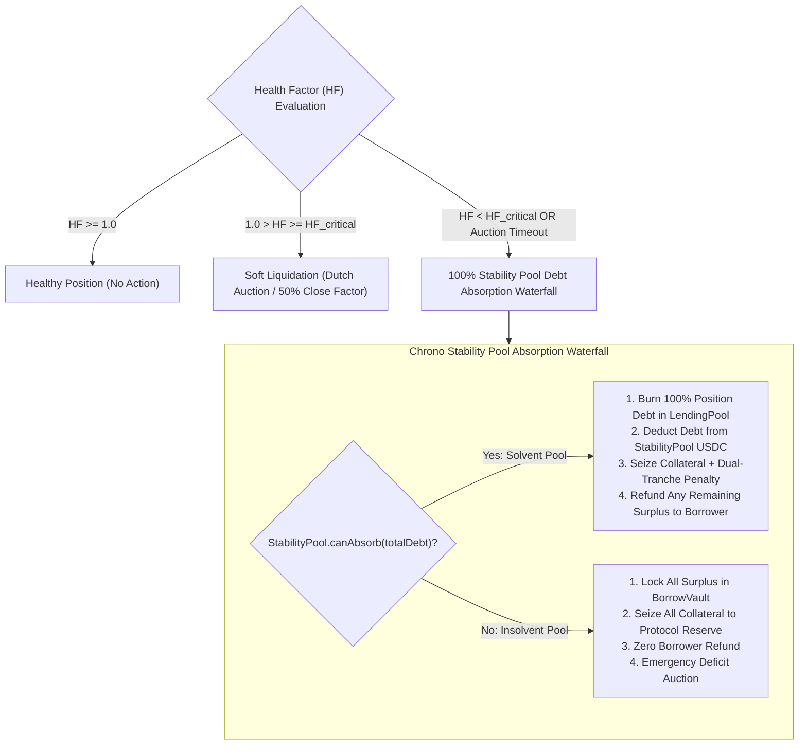

# Infinite-Duration Loan Architecture Specification

**Author:** Ishaan Singh (`lordryuga`)  
**Project:** Chrono Protocol on Hedera  
**Status:** Architectural Specification  
**Date:** October 2026  

---

## 1. Executive Summary & Problem Statement

Chrono Protocol natively introduces time-deterministic borrowing on Hedera by coupling collateralized debt positions with the **Hedera Schedule Service (HSS, `0x16b`)**. For short-term credit facilities ($\le 60$ days), HSS provides autonomous, zero-keeper hard liquidations at loan maturity ($T_{\text{expiry}} + \text{GRACE\_PERIOD}$).

However, Hedera network consensus enforces a hard boundary on scheduled transaction lifespans:
$$\text{scheduling.maxExpirationTime} \approx 62 \text{ days}$$
To guarantee defense-in-depth safety against opaque precompile reverts (`SCHEDULE_EXPIRATION_TIME_TOO_FAR_IN_FUTURE`, RC 306), Chrono enforces a strict protocol ceiling of **60 days (`5,184,000` seconds)** on all scheduled loans.

While 60 days is optimal for short-term liquidity, structured credit, and options hedging, institutional and retail DeFi participants routinely require **perpetual (infinite-duration) credit lines** (analogous to Aave v3, Compound v3, and MakerDAO/Sky). Such loans have no fixed expiry date and remain open indefinitely as long as the borrower maintains a solvent Health Factor ($HF \ge 1.0$).

This document formally specifies the **Dual-Mode Architectural Engine** for Chrono Protocol:
1. **Mode A (Hedera-Native Fixed-Term):** $0 < \text{duration} \le 60$ days. Uses HSS scheduled hard liquidation, fixed/discounted duration pricing, and deterministic liquidity recycling.
2. **Mode B (Aave-Style Infinite Perpetual):** $\text{duration} = 0$ (perpetual). Bypasses HSS scheduling, utilizes floating continuous interest compounding via the **Global Cumulative Borrow Index ($I_t$)**, and protects lender solvency through an atomic **100% Debt Absorption Stability Pool Waterfall** triggered whenever $HF < 1.0$.

---

## 2. Mathematical & Economic Model

### 2.1 Floating Interest Accrual via Global Cumulative Index

Unlike fixed-term positions which lock in an interest rate or upfront fee at origination, perpetual loans accrue floating interest continuously based on reserve pool utilization ($U_t$).

The **Global Cumulative Borrow Index** $I_t$, initialized at $I_0 = 1.0 \times 10^{18}$ (WAD), advances over any elapsed time $\Delta t = t - t_{\text{last}}$ according to:
$$I_t = I_{t_{\text{last}}} \times \left(1 + \frac{\text{borrowAPY}(U_t) \times \Delta t}{\text{SECONDS\_PER\_YEAR}}\right)$$

When an infinite-duration loan $i$ is opened at timestamp $t_0$, the position records:
- Principal borrowed: $D_{i,0}$
- Entry index: $I_{i,\text{entry}} = I_{t_0}$

At any subsequent block timestamp $t$, the current gross debt $D_{i,t}$ is evaluated lazily or periodically as:
$$D_{i,t} = D_{i,0} \times \frac{I_t}{I_{i,\text{entry}}}$$

#### Mathematical Equivalence & Lazy Evaluation
As proven in Phase 2 unit testing (`test/InterestEngine.test.ts`), simple interest compounding over linear intervals exhibits negligible variance ($< 0.0001\%$) between continuous hourly updates and on-demand lazy updates during user interactions (`repay`, `borrowMore`, `liquidate`). Therefore, infinite-duration loans do not require hourly keeper calls to maintain mathematical accuracy.

---

### 2.2 Utilization & Kinked Interest Rate Model

To eliminate the asset-liability mismatch of open-ended credit pools without forced expirations, Chrono utilizes a two-slope kinked rate curve:

$$
\text{borrowAPY}(U) = 
\begin{cases} 
R_{\text{base}} + \frac{U}{U_{\text{optimal}}} \times R_{\text{slope1}} & \text{if } U \le U_{\text{optimal}} \\
R_{\text{base}} + R_{\text{slope1}} + \frac{U - U_{\text{optimal}}}{1 - U_{\text{optimal}}} \times R_{\text{slope2}} & \text{if } U > U_{\text{optimal}}
\end{cases}
$$

| Parameter | Recommended Value | Rationale |
| :--- | :--- | :--- |
| **Optimal Utilization ($U_{\text{optimal}}$)** | $80\%$ | Guarantees $20\%$ of liquidity remains available for instant depositor withdrawals. |
| **Base Rate ($R_{\text{base}}$)** | $1.0\%$ | Baseline minimum borrowing cost. |
| **Slope 1 ($R_{\text{slope1}}$)** | $4.0\%$ | Moderate cost curve when pool is liquid ($U \le 80\% \implies \text{APY} \le 5.0\%$). |
| **Slope 2 ($R_{\text{slope2}}$)** | $60.0\%$ | Punitive spike when $U > 80\% \implies \text{APY}$ reaches up to $65\%$, strongly incentivizing borrowers to repay or external lenders to deposit. |

---

### 2.3 Perpetual Risk & Health Factor Formulation

Because infinite-duration loans possess no terminal timestamp $T_{\text{expiry}}$, the time-decay factor $k_{\text{decay}}$ from Chrono's fixed-duration model is set to 0.

The collateral parameters are static base values:
$$\text{MaxLTV}_{\text{perpetual}} = \text{LTV}_{\text{base}}$$
$$\text{LiquidationThreshold}_{\text{perpetual}} = \text{LT}_{\text{base}} = \text{LTV}_{\text{base}} + \text{Buffer}_{\text{min}}$$

The instantaneous Health Factor $HF_i$ is defined as:
$$HF_i = \frac{C_i \times P_{\text{collateral}} \times \text{LT}_{\text{base}}}{D_{i,t} \times P_{\text{debt}}}$$

Where:
- $C_i$: Collateral balance locked in `BorrowVault`.
- $P_{\text{collateral}}, P_{\text{debt}}$: Real-time Pyth oracle prices normalized to $10^{18}$.
- $D_{i,t}$: Cumulative accrued debt at current timestamp.

Position status is classified into three operational regimes:
1. **Solvent / Healthy ($HF \ge 1.0$):** Position remains uninhibited. No liquidation possible.
2. **Soft Liquidation Eligible ($HF_{\text{critical}} \le HF < 1.0$):** Collateral buffer is breached. External liquidators may partially repay debt (up to 50% close factor) via Dutch auction or fixed bonus to restore $HF > 1.15$.
3. **Hard Liquidation Threshold ($HF < HF_{\text{critical}}$ or $HF < 1.0$ when soft auction fails):** The position is submitted to the **100% Debt Absorption Stability Pool Waterfall**.

---

## 3. Liquidation Architecture for Infinite Loans



### 3.1 Why 100% Debt Absorption is Mandatory for Perpetual Loans

In fixed-term loans, the borrower accepts hard liquidation at expiry because the loan term has ended. In perpetual loans, allowing undercollateralized positions to linger without expiration risks **bad debt accumulation** during sharp market drawdowns.

To ensure absolute lender safety:
1. **Zero Bad Debt Invariant:** When $HF < 1.0$, the protocol does not rely on third-party liquidators having sufficient capital. The Chrono **Stability Pool** acts as the decentralized backstop of first resort.
2. **Complete Debt Extinguishment:** The Stability Pool absorbs **100%** of the outstanding debt $D_{i,t}$ in a single atomic transaction.
3. **Restoration of Lending Pool:** The debt is marked repaid in `LendingPool`, immediately releasing borrowed liquidity back to depositors and restoring pool utilization.

### 3.2 Dual-Tranche Penalty Distribution
Upon 100% absorption, collateral is liquidated according to the dual-tranche penalty model:
$$\text{Penalty}_{\text{total}} = \max\left(\text{Debt} \times \text{penaltyRate}, \text{Collateral} \times \text{floorRate}\right)$$
- **Stability Pool Share ($70\%$):** Awarded to Stability Pool depositors as yield for providing backstop liquidity.
- **Protocol Reserve Share ($30\%$):** Deposited into protocol reserve treasury to cover black-swan shortfalls.
- **Borrower Equity Protection:** If $\text{CollateralValue} > \text{Debt} + \text{Penalty}_{\text{total}}$, the residual surplus collateral is automatically returned to the borrower's wallet.

---

## 4. Contract Architecture & Modifications Required

### 4.1 `BorrowVault.sol`

To support perpetual loans alongside fixed-term loans, `BorrowVault` introduces a sentinel value for `durationSeconds`:
- `durationSeconds == 0`: Designates an **Infinite Perpetual Loan**.
- `0 < durationSeconds <= 60 days`: Designates a **Fixed-Term HSS-Scheduled Loan**.
- `durationSeconds > 60 days`: Reverts with `ErrorLib.DurationExceedsScheduleLimit`.

```solidity
struct Position {
    address borrower;
    address collateralToken;
    address debtToken;
    uint256 collateralAmount;
    uint256 principalDebt;
    uint256 entryBorrowIndex;      // Index snapshot at origination
    uint256 expiryTimestamp;       // 0 for infinite/perpetual positions
    bool isInfinite;               // Flag indicating perpetual mode
}
```

#### Origination Branching
```solidity
function openPosition(
    address onBehalfOf,
    address collateralToken,
    address debtToken,
    uint256 collateralAmount,
    uint256 borrowAmount,
    uint256 durationSeconds
) external nonReentrant returns (bytes32 positionId) {
    if (durationSeconds > MAX_BORROW_DURATION) {
        revert ErrorLib.DurationExceedsScheduleLimit(durationSeconds, MAX_BORROW_DURATION);
    }

    bool isInfinite = (durationSeconds == 0);
    uint256 maxLtv;
    uint256 expiry = 0;

    if (isInfinite) {
        // Perpetual loan: static base LTV, no HSS schedule
        maxLtv = riskEngine.getBaseLTV(collateralToken);
    } else {
        // Fixed loan: duration-decayed LTV, HSS schedule
        maxLtv = riskEngine.computeMaxLTV(collateralToken, durationSeconds);
        expiry = block.timestamp + durationSeconds;
    }

    // Validate LTV & Transfer Collateral...
    
    // Conditional HSS Scheduling:
    if (!isInfinite) {
        schedulerEngine.scheduleHardLiquidation(positionId, expiry);
    }

    // Record initial borrow index from InterestEngine
    uint256 currentIndex = interestEngine.updateReserveIndices(debtToken);
    positions[positionId] = Position({
        borrower: onBehalfOf,
        collateralToken: collateralToken,
        debtToken: debtToken,
        collateralAmount: collateralAmount,
        principalDebt: borrowAmount,
        entryBorrowIndex: currentIndex,
        expiryTimestamp: expiry,
        isInfinite: isInfinite
    });
}
```

#### Dynamic Debt Resolution
```solidity
function getPositionDebt(bytes32 positionId) public view returns (uint256) {
    Position memory pos = positions[positionId];
    if (pos.principalDebt == 0) return 0;
    
    if (pos.isInfinite) {
        uint256 currentIndex = interestEngine.getBorrowIndex(pos.debtToken);
        return MathLib.wadMul(pos.principalDebt, MathLib.wadDiv(currentIndex, pos.entryBorrowIndex));
    } else {
        // Fixed rate upfront / duration accrued
        return pos.principalDebt + computeFixedAccruedInterest(pos);
    }
}
```

---

### 4.2 `LiquidationEngine.sol`

`LiquidationEngine` adds an explicit execution target for perpetual hard liquidations:

```solidity
/// @notice Permissionless hard liquidation trigger for perpetual loans with HF < 1.0
function executePerpetualHardLiquidation(bytes32 positionId) external nonReentrant returns (bool) {
    Position memory pos = borrowVault.getPosition(positionId);
    require(pos.isInfinite, "Position is fixed-term; handled by HSS");

    uint256 hf = riskEngine.computeHealthFactor(positionId);
    require(hf < MathLib.WAD, "Position is healthy (HF >= 1.0)");

    // Execute 100% Stability Pool waterfall absorption
    return _executeHardLiquidationInternal(positionId);
}
```

---

## 5. Architectural Comparison Matrix

| Feature | Fixed-Term Mode (HSS-Native) | Infinite Perpetual Mode (Aave-Style) |
| :--- | :--- | :--- |
| **Duration Limit** | $\le 60$ days (`5,184,000` s) | Unbounded ($\infty$, `duration == 0`) |
| **Hedera Schedule Service (0x16b)** | Active (Autonomous call at $T_{\text{expiry}} + 902\text{s}$) | Bypassed (Zero HSS gas overhead) |
| **Interest Pricing** | Fixed upfront / duration-bound rate | Variable floating (Global Index $I_t$) |
| **Index Keeper Dependency** | None (Static rate locked at entry) | Lazy evaluation (or optional HSS keeper) |
| **Liquidation Trigger** | Deterministic timestamp arrival | Collateral health degradation ($HF < 1.0$) |
| **Liquidation Execution** | HSS scheduled call $\rightarrow$ `executeHardLiquidation` | Permissionless bot / keeper trigger $\rightarrow$ `executePerpetualHardLiquidation` |
| **Liquidation Depth** | 100% Debt Absorption by Stability Pool | 100% Debt Absorption by Stability Pool |
| **Borrower Use Case** | Tactical trading, fixed-horizon arbitrage, hedging | Long-term capital leverage, collateralized lines of credit |

---

## 6. Implementation & Rollout Roadmap

1. **Phase 1 (Completed):** Defense-in-depth 60-day loan duration ceiling enforced across `BorrowVault`, `SchedulerEngine`, and `AssetRegistry`.
2. **Phase 2 (Completed):** Minimal Global Cumulative Borrow Index ($I_t$) and HSS periodic keeper with dev toggle implemented in `InterestEngine` and `SchedulerEngine`.
3. **Phase 3 (Completed):** HCS Real-Time Audit Stream established with automated keeper topic submission and HashScan explorer badges.
4. **Phase 4 (This Specification):** Formal specification of Infinite-Duration Loan Architecture and 100% Stability Pool debt absorption waterfall.
5. **Phase 5 (Next Protocol Upgrade):**
   - Implement `isInfinite` sentinel branch in `BorrowVault.sol` and `LiquidationEngine.sol`.
   - Update frontend borrowing interface (`chrono-hedera-frontend`) with a toggle switch: `[ Fixed Term (<= 60d) | Perpetual (Floating) ]`.
   - Update backend indexer (`chrono-hedera-backend`) to index perpetual positions and track live Health Factors via mirror node WebSocket streams.
