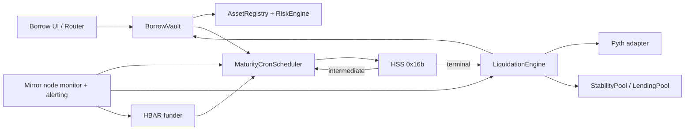

# Issue #12: modular HSS liquidation cron architecture

**Status:** implementation proposal for review  
**Branch:** `dev-laddu`  
**Scope:** fixed maturity loans longer than one Hedera Schedule Service (HSS) scheduling horizon. No protocol code is changed by this document.  
**Source issue:** [Chrono #12](https://github.com/mdgspace/Chrono_hedera/issues/12)

## 1. Decision and safety boundary

Introduce a dedicated `MaturityCronScheduler` contract with the same vault facing `scheduleHardLiquidation(positionId, maturity)` and `cancelSchedule(positionId)` operations, plus a permissionless, idempotent `advance(positionId, generation)` recovery operation. At origination, it creates **one** HSS schedule. An intermediate schedule calls `advance`, which creates the next schedule. The final schedule calls `LiquidationEngine.executeHardLiquidation(positionId)` directly, as issue #12 requests. The position's maturity and the 15 minute repayment grace period remain authoritative in `BorrowVault` and `LiquidationEngine`; an HSS callback never grants itself liquidation rights early.

**A chain is not a guarantee of eventual execution.** A failed scheduled call, insufficient HBAR, saturated second, network change, or failed liquidation can consume the only scheduled hop. Permissionless recovery, independent monitoring, and manual liquidation after maturity are required. Marketing and UI must say “scheduled, with monitored recovery,” not “guaranteed autonomous liquidation.”

Do not offer truly unbounded `uint256` duration to borrowers. The scheduler can calculate any representable timestamp, but production admission must have a governed maximum term, maximum hop count, per asset risk limits, and a funded fee policy. An unlimited term creates unlimited future operating liability and an overflow/interest risk. The initial maximum should be selected from risk and funding analysis, not hardcoded as a new network limit.

This is a **fixed maturity** feature. The separate [infinite duration proposal](../analysis/INFINITE_DURATION_LOAN_ARCHITECTURE.md) uses `duration == 0` and a different liquidation rule. It must not be silently folded into this change. If both modes ship, use an explicit loan type; preserve `duration == 0` only for a separately reviewed perpetual design.

## 2. Existing architecture and gaps

| Area | Current behavior | Consequence for issue #12 |
| --- | --- | --- |
| `BorrowVault.openPosition` | Rejects durations over 60 days and stores one `scheduledTxAddress` in `Position`. | Remove the network cap only after a durable job can be created; stop treating that field as the current schedule after hop 1. |
| `AssetRegistry` / `RiskEngine` | Registry caps `maxBorrowDuration` at 60 days (default 30); risk engine checks duration against asset min/max. | Per asset limits and risk curves must be deliberately extended. Scheduler support alone does not admit long loans. |
| `SchedulerEngine` | One `positionSchedules` address; direct final liquidation; capacity search only +5 seconds; cancellation clears state regardless of HSS delete result. It also runs an unrelated hourly index keeper. | One-address mapping cannot represent generations or failure states. Keep index scheduling isolated from loan cron funding and state. |
| `LiquidationEngine.executeHardLiquidation` | Permissionless; checks `startTime + duration + 900`; uses live Pyth prices and Stability Pool capacity. | Safe against early callback but a stale price or failed waterfall can consume the terminal schedule. |
| `BorrowVault.repay` and liquidation closure | Full repayment or close calls `cancelSchedule`; partial repayment retains schedule. | Cancellation must invalidate future hops even when HSS deletion fails. |
| Web/backend | Borrow form enforces 60 days; backend indexes position duration but not scheduler health. | Show allowed asset term, maturity, current hop, fee/coverage status and recovery alerts. |
| Deployment | Deployer funds current scheduler with a best effort 10 HBAR transfer. | A fixed deployment balance is not a long term funding policy. New scheduler and monitoring need explicit setup. |

Two current code paths need correction before long terms are enabled:

1. `SchedulerEngine.scheduleHardLiquidation` checks `maturity <= now + 60 days`, then schedules `maturity + 900 + 2 + jitter`. Thus even a nominal 60 day loan attempts a schedule beyond the stated 60 day protocol envelope. All horizon checks must apply to the **actual HSS execution second**.
2. `InterestEngine.accrueInterest` returns only the **new increment**, while `BorrowVault.repay` and both liquidation paths calculate `principal + returnedIncrement`. Previously accrued interest stored in `InterestEngine.positions[positionId].accruedInterest` is omitted on later calls. Correct the debt accounting with a single authoritative total debt API and reconciliation tests before increasing exposure to multi year terms. Also check the existing `RiskEngine.computeHealthFactor` call to `computeMaxLTV(remainingDuration)`: it reverts when remaining duration falls below the asset's `minBorrowDuration`, potentially disabling soft liquidation near expiry. These are existing issues made more consequential by this feature.

## 3. HSS facts and assumptions to validate

[HIP-1215](https://github.com/hiero-ledger/hiero-improvement-proposals/blob/main/HIP/hip-1215.md) defines `scheduleCall`, `deleteSchedule`, and `hasScheduleCapacity`. A scheduled call may recursively schedule another call; the payer must have HBAR for scheduling and execution. A `scheduleCall` failure returns a response code and zero address. `hasScheduleCapacity` checks a particular second and gas limit, and returns false for invalid or too distant seconds. A successful capacity check is not proof that a future **execution** will succeed.

The issue and existing protocol use 60 days as a conservative ceiling under the network's documented 62 day maximum. The consensus node's [`SchedulingConfig.maxExpirationFutureSeconds`](https://github.com/hiero-ledger/hiero-consensus-node/blob/main/hedera-node/hedera-config/src/main/java/com/hedera/node/config/data/SchedulingConfig.java) defaults to 5,356,800 seconds (62 days); it is a network property, so verify the target network before deployment. Do not assume the excess 2 days is permanently available. The HIP says scheduled seconds must be strictly in the future; [Hedera's scheduled transaction documentation](https://docs.hedera.com/hedera/core-concepts/scheduled-transaction) describes execution at the earliest available consensus time after expiry on a best effort basis. Neither source promises precise wall clock execution, fee availability, or successful inner contract calls.

**Release gate:** demonstrate on the target Hedera testnet that a plain contract (no `delegatecall`) can create an HSS self call, have that call create another HSS call, pay both, and delete a pending call. Record schedule IDs, consensus timestamps, response codes and child transaction results. Also test the exact failure/recovery path. There are [reported testnet payer signature failures for schedules created through `delegatecall`](https://github.com/hiero-ledger/hiero-consensus-node/issues/27263); avoid that pattern and treat any payer/signature failure as a blocked rollout until resolved. Do not switch to `executeCallOnPayerSignature` as a fallback because its timing semantics differ from `scheduleCallWithPayer` and could execute before maturity.

## 4. Target component boundaries



`MaturityCronScheduler` owns only loan timer state, HSS calls, and fee reserve bookkeeping. The current `SchedulerEngine` index keeper remains a separate service during migration; longer term, rename it to `IndexScheduler` so index job failure or public calls cannot drain the liquidation scheduler balance. `BorrowVault` remains the loan authority. `LiquidationEngine` remains the sole place that decides whether and how to liquidate. The monitor is operational recovery, not a source of financial truth.

**Upgrade topology:** these are nonproxy contracts with mutable `initialize` methods. Do not rewire an existing vault to a new scheduler while it has live positions: closure of an old position would ask the new scheduler to cancel a schedule held by the old one. Prefer a new vault/scheduler deployment for new loans while old contracts run to maturity. If in place migration is unavoidable, add a per position scheduler address and a tested migration process before rewiring, with no interval where a position loses its cancellation authority. Restrict one time initialization or validate any allowed reconfiguration; the current `initialize` functions are repeatable by `owner`.

## 5. Job model and state machine

Suggested storage per `positionId`:

```solidity
enum JobStatus { None, Scheduled, AdvanceRequired, TerminalDue, Closed }
struct Job {
    uint64 generation;            // increment after each successfully created hop
    uint64 nextExecutionAt;       // requested HSS second, not guaranteed actual second
    uint64 maturityAt;            // immutable loan maturity
    uint64 liquidationAt;         // maturity + grace + terminal safety offset
    address pendingSchedule;      // single current schedule ID; zero when closed
    JobStatus status;
    uint32 successfulHops;
}
mapping(bytes32 => Job) jobs;
```

Use sufficiently wide checked timestamp types if `uint64` is chosen. Keep `generation` monotonic; never reuse a job ID. `positionId` uniqueness is only local to a vault, so namespace the key by vault address or use a scheduler dedicated to one immutable vault. Record `vault` and `liquidationEngine` immutably in the new deployment if feasible. Do not create a generic arbitrary target/calldata scheduling API callable by users.

| State/event | Required transition |
| --- | --- |
| Origination | Vault validates term/risk/funding, creates position, then creates first schedule atomically. If HSS creation fails, the whole borrow reverts. Commit `generation = 1`, requested execution second, and returned schedule address. |
| Intermediate callback | `advance(id, generation)` checks that the vault position is active, maturity and generation match, and `now >= nextExecutionAt`. It selects a next second from absolute `liquidationAt`, creates exactly one next schedule, increments generation, updates pending address, and emits old/new schedule IDs and status. |
| Public recovery | Same `advance` path is callable by anyone when due. If an HSS callback failed or never arrived, a keeper can reattempt after a bounded delay. A competing or stale callback sees the generation changed and returns without creating anything. |
| Terminal callback | Direct `executeHardLiquidation(id)` rechecks active state and `now >= maturity + grace`. On success, vault closes position and invalidates scheduler job. On failure, a public retry is possible; monitor records the failure cause. |
| Full repayment or full soft/hard close | Vault marks position inactive before external cancellation; scheduler invalidates the job/generation first, then attempts `deleteSchedule`. Emit the actual HSS return code. A failed delete leaves an inert callback but must raise an operational alert and not erase proof of the failed deletion. |
| Partial repayment/top up | Position remains active and maturity unchanged; existing schedule remains valid. If an extension/refinance feature is added later, it must explicitly cancel and replace the job with a new generation and funding quote. |

The state machine must distinguish a schedule **created** from one **successfully executed**. HSS may consume a schedule whose inner EVM call reverts. Never infer execution success from the schedule ID or a `hasScheduleCapacity` result. A successful `advance` event confirms the next hop was created; a `HardLiquidation` and inactive position confirm terminal completion. If a schedule is past due and neither event exists, mark it `AdvanceRequired`/`TerminalDue` in the monitor. On chain status may remain `Scheduled` when a call failed before entering EVM; public recovery must still work from the due time.

## 6. Timing algorithm

Let `T0 = block.timestamp` at origination, `M = T0 + duration`, `G = 900 seconds`, and `L = M + G + terminalOffset` (currently the code uses `+2`). The terminal schedule is never earlier than `L`; the liquidation contract independently enforces `now >= M + G`.

Set `H = min(verifiedNetworkMaxExpiration - safetyMargin, deploymentHopPolicy)`. Use a 60 day production hop policy, and **60 seconds in a test-only deployment**. This is a scheduler policy, not a change to Hedera's network limit. Make the hop policy immutable per deployment (or compile it into a dedicated fixture), with no owner method that can change a production scheduler to 60 seconds. Reserve explicit room for candidate second jitter and minimum lead time; the 60 day value is not a license to add `G` after the check. A scheduler call at time `t` may request only `t < requestedSecond <= t + H`, with `requestedSecond + maxJitter` still inside that bound. A candidate must also pass `hasScheduleCapacity(candidate, gasLimit)` and a successful `scheduleCall` response check.

The conceptual hop count is `ceil((L - T0) / H)` for a chain that can consume full hops. Actual intermediate count can change when calls are delayed or when slot search shifts a second. Compute each next hop from the **absolute** `L` and the current consensus time, not by decrementing a precomputed `N` or adding 60 days to the last requested second:

```text
remaining = L - now
if now >= L: execute/retry hard liquidation through the existing permissionless path
else if remaining <= H - jitterReserve: schedule terminal call at L or first allowed second within bounded terminal window
else: schedule advance(positionId, nextGeneration) at now + H - jitterReserve
```

The `now >= L` branch is relevant to recovery after a missed hop: it must not attempt to create an HSS call in the past. If `now` is after maturity plus grace but before `L`, callers can still use `executeHardLiquidation` directly. Never let a delayed intermediate callback extend the economic maturity or repayment grace. A 60 day loan is an important boundary example: `L` is later than day 60, so with `H = 60 days` it needs an intermediate hop or a shorter initial term. A 120 day loan generally needs more than two HSS calls because grace and safety offset cross the boundary. Document and quote the actual call count, not `ceil(duration / 60 days)` alone.

Capacity search is bounded and only moves a requested execution second **later**. The effective search window is `min(configuredSearchWindow, now + H - idealSecond)`. In the one minute test deployment, choose an exact `idealIntermediateDelay = 45 seconds` and a maximum 15 second later-slot search, so every candidate remains within `now + 60 seconds`. This 45 second value is a test configuration chosen to leave bounded capacity-search room; it is not a Hedera rule, a production offset, or the loan's duration. The production hop delay comes from the verified network horizon and production safety margin. For terminal hops, capacity movement delays liquidation beyond grace; show the upper bound in UI and risk monitoring. If no acceptable slot is found, revert origination. For a later hop, leave the existing job recoverable; expose the HSS response code through a custom error and transaction receipt for the monitor. A reverted EVM call cannot emit a lasting failure event. Never declare the position scheduled without an HSS address.

## 7. API, authorization, and ordering

- Preserve vault facing `scheduleHardLiquidation` and `cancelSchedule` signatures where possible, but return a job identifier or first schedule address explicitly documented as **initial only**. Add `getJob(positionId)` and `previewSchedule(maturity)`/fee quote for frontend and monitoring. Add events `JobCreated`, `HopScheduled`, `HopAdvanced`, `JobClosed`, `ScheduleDeleteResult`, and `RecoveryNeeded` with position, generation, schedule address, requested second, and HSS response code.
- `scheduleHardLiquidation` is callable only by its immutable vault. Require a nonzero, currently active position with exact matching maturity before creating a job; because current `BorrowVault` calls scheduler before storing `_positions[positionId]`, reorder origination to store the position before scheduling, while retaining full transaction atomicity. Then initialize interest and disburse tokens in an audited checks/effects/interactions order. If a callback could execute in the same transaction, guard against it; HSS requires a future second.
- `advance` may be permissionless because it accepts no caller supplied destination, calldata, fee withdrawal address, or new maturity; it acts only after its stored due second. Check active position and unchanged maturity, generation, pending schedule, time, and status. Update state only after a successful HSS creation; use `nonReentrant`. Stale generations must be harmless no ops, including after a repay or a manually advanced hop.
- `cancelSchedule` only from vault. Invalidate job before attempting HSS deletion. An HSS delete failure after an early close must not block repayment or refund; preserve the response code and stale address for reconciliation. Guard any withdraw/refund of unused HBAR so a user cannot drain a shared scheduler balance.
- Terminal `executeHardLiquidation` remains permissionless and idempotent for inactive positions. The vault calls scheduler cancellation during liquidation; exercise that HSS can tolerate a delete attempt on the currently executing schedule. If it cannot, record/ignore that specific failure without reverting liquidation.
- Limit ownership controls: timelocked, monitored changes to gas caps, window, vault/engine addresses, fee parameters and emergency pause. A pause must stop new long loans and new HSS hops only with a documented rescue path; it must not block borrower repayment or permissionless matured liquidation. Do not let an owner silently extend existing maturities or redirect terminal calls.

## 8. Fees, gas and resource limits

Budget separately for (a) HSS schedule creation fees on each hop, (b) scheduled callback gas/fees, (c) final liquidation gas/fees, (d) capacity retries, (e) cancellation, and (f) permissionless recovery. `executeGasLimit = 3_000_000` is shared today; measure an intermediate hop and a worst case terminal liquidation separately, then set bounded job specific limits. Larger gas limits reduce available HSS capacity per second. HBAR is not ERC20 debt collateral; keep a dedicated reserve with explicit accounting and withdraw policy.

Recommended admission model: quote a maximum approved hop count and worst case cost in HBAR, collect a borrower schedule service deposit or allocate a ring fenced protocol reserve, and reserve it per job. Require enough liquid HBAR for **at least the next hop and terminal fallback** before disbursing a loan. A multi year promise cannot safely rely on the deployer's one time 10 HBAR transfer. Since future gas/fee prices can change, maintain a funded buffer and top up operations; publish a shortfall alert. Define who pays when cost exceeds the deposit, and how unused funds are refunded on early repayment. No user supplied duration should cause an unbounded loop or a giant `N`-sized array at origination; store O(1) state per position and cap accepted `N`.

Accounting invariants: total withdrawable HBAR must exclude all job reservations; a failed HSS creation cannot debit a job permanently; a job cannot be charged for a stale generation; only one funded next hop is considered live; a balance below reserve floor blocks new borrowing, not repayment. If HSS charges fees before a failed execution, make the loss visible rather than assuming it is refunded. Monitor actual HSS payer balance, per job reserved amount, fee rate, gas usage, schedule creation failure codes, and upcoming maturity concentration.

## 9. Changes elsewhere in the protocol

| Component | Planned change / review |
| --- | --- |
| `contracts/engines/SchedulerEngine.sol`, `ISchedulerEngine.sol` | Introduce dedicated maturity cron module and interface; leave index keeper separate. Provide fixed target and idempotent generation state. If retaining the name, isolate index funds and methods structurally. |
| `contracts/core/BorrowVault.sol`, `PositionLib.sol`, `IBorrowVault.sol` | Remove hard 60 day term check after new admission policy is ready. Store authoritative maturity and scheduler identity; avoid exposing first `scheduledTxAddress` as current address. Preserve full/partial repayment semantics and atomic origination. |
| `contracts/core/AssetRegistry.sol`, `IAssetRegistry.sol`, `RiskEngine.sol` | Replace global 60 day ceiling with governed global maximum plus per asset max. Validate `min <= max`, risk parameter ranges and active asset state on update. Recalibrate LTV/threshold for long exposure; fix health factor computation at remaining duration below minimum. |
| `contracts/engines/LiquidationEngine.sol` | Keep maturity and grace checks. Add terminal failure observability and retry guidance. Review waterfall solvency and stale oracle behavior; do not make HSS success depend on external keeper timing without a recovery path. |
| `contracts/engines/InterestEngine.sol`, `MathLib.sol` | Fix debt accounting mentioned above. Bound `annualRate * elapsed` and `compoundInterest` overflow/sentinel behavior for long idle periods; test accrual across years and rate changes. Decide rate lock versus floating terms and disclose it to borrowers. |
| `contracts/oracle/PythOracleAdapter.sol` | A 120 second fresh price requirement can make terminal execution revert if the keeper is down. Define a safe delayed liquidation policy: do not use stale prices; alert and retry after refresh, and model interim insolvency risk. |
| `StabilityPool`, `LendingPool` and risk policy | Longer locked debt changes utilization, withdrawal liquidity, pool capacity at maturity cliffs, bad debt exposure and collateral concentration. Forecast scheduled maturity debt against Stability Pool funds; complete or explicitly accept the separate bad debt fallback task before large long term limits. |
| `ChronoRouter`, frontend, ABIs | Keep router `durationSeconds` but expose per asset supported term, maturity, estimated hops and schedule fee. Replace hardcoded 60 day form cap; distinguish maturity from next HSS hop and show degraded scheduling status. |
| Backend indexer / database | Index scheduler events and HSS schedule results keyed by vault, position and generation; support pagination and independent cursors. Track missed hops, stale oracle, payer balance, terminal failures, current schedule address and superseded schedules. Do not derive job health solely from `PositionOpened` or stored first address. |
| Deployment / operations | Deploy and fund new module, validate on chain wiring, schedule a canary short loan and multi hop testnet loan, set alert thresholds, and document permissionless recovery transactions. Keep old stack operating until its positions close. |
| Protocol docs / economics | Reconcile whitepaper's 60 day product claim with fixed multi hop loans and the separate perpetual proposal. Document that maturity remains fixed even if a hop fails and that execution can be delayed. |

## 10. Threat model and controls

| Threat / failure | Impact | Control and proof required |
| --- | --- | --- |
| Public `advance` invoked early, repeatedly, or with forged position | Premature liquidation or HBAR drain | Stored due time, exact generation, immutable target, active vault position and maturity checks; fuzz early/replay/unknown IDs. |
| Public recovery and scheduled callback are ordered close together | Duplicate schedules and fees | Generation compare and single transaction state transition; stale callback no op; test both whole-transaction orderings. Hedera consensus transactions do not interleave EVM instructions. |
| Repayment and a due hop are ordered close together | Closed loan still liquidated; repayment reverts | Mark inactive first; invalidate scheduler job; terminal liquidation returns for inactive position; handle HSS delete codes; test repayment-first and callback-first orderings. |
| HSS deletion fails | Orphan schedule consumes funds or executes stale payload | Record code/address; invalidate generation; callback checks active state; alert and retry deletion only where safe. |
| Intermediate callback is overdue or its inner call failed | Loan loses future schedule silently | Monitor schedule and child result, due time watchdog, permissionless `advance`, bounded recovery SLA and incident runbook. |
| Schedule creation succeeds but next callback fails from insufficient payer HBAR, signature, gas or network change | Chain stops; maturity debt unresolved | Per job reserve, balance floor, testnet canary, payer/signature probe, receipt monitoring, independent funded rescue. |
| Terminal call reverts on stale oracle, insufficient Stability Pool, token failure, math overflow or too little gas | Debt stays open beyond maturity | Keep permissionless liquidation, refresh oracle, investigate waterfall/fallback, gas benchmark, monitor and retry. Never bypass price freshness to force closure. |
| Capacity saturation or adversarial slot crowding | Failed borrow/hop or delayed liquidation | Bounded later slot search, gas sizing, maturity staggering, explicit maximum lateness, failure events and recovery. |
| Owner changes scheduler wiring, gas or fee settings, or drains HBAR | Mass missed expiries | Immutable critical addresses where possible; timelock/multisig, bounded setters, reserves excluded from withdrawals, config change alerts, emergency runbook. |
| Very long terms interact with risk/interest math | Undercharged debt, unliquidatable positions, insolvency | Governed term cap, bounded APY/accrual math, monotonic debt invariant, long horizon risk simulation and oracle/health regression tests. |
| Existing live vault is rewired to new scheduler | Old schedule cannot be cancelled; orphaned positions | Parallel deployment or per position scheduler migration with reconciliation; no blind owner `initialize` call. |
| Index keeper and liquidation cron share balance | Index recurrence starves maturity jobs | Dedicated payer/reserves or enforced allocation; priority alerts and pause of nonessential index job. |

## 11. Implementation sequence and acceptance gates

1. **Network feasibility gate.** Validate multi hop HSS self chaining, schedule deletion, payer behavior, response codes, gas and fees on target testnet. Confirm target network's horizon setting and deployment version. If failed, defer long term admission and use an explicitly monitored off chain scheduler design only after separate review.
2. **Core accounting and risk gate.** Correct total accrued debt and near maturity health factor behavior. Add bounded duration, APY and timestamp math. Choose long term loan pricing and per asset limits using the separate risk model work.
3. **Cron module.** Implement storage, preview, origination, intermediate generation transition, cancellation, response code handling, funding and permissionless recovery. Preserve O(1) per position storage and creation work.
4. **Vault and liquidation integration.** Reorder atomic origination, expose current job state, maintain full repayment and closure behavior, and benchmark terminal gas/fee scenarios. Ensure time checks live in liquidation contract and are independent of scheduler state.
5. **Monitoring and user surface.** Index each HSS schedule and result; alert before and after missed hops, payer shortfall, failed terminal calls and maturity cliffs. Update frontend allowed duration and scheduler status. Publish a runbook for funding, retries, canaries and pause.
6. **Rollout.** Deploy an isolated new stack or proven per position migration. Start with low loan size and a small long term cap, canary multi hop path on testnet, audit external call and cancellation paths, then increase limits through governance. Do not expose multi year loans before the live monitor and funded recovery work.

Acceptance criteria: representative terms below one hop, exactly at the effective horizon, just beyond it, 120 days in arithmetic-only tests, and the approved maximum; a schedule is always created or borrow reverts; no callback liquidates before maturity plus grace; an overdue or failed intermediate hop can be recovered without a second active job; full repayment prevents any later liquidation; terminal failure is visible and manually retryable; actual HSS and job state reconcile; reserves cover the approved worst case next action; old positions retain their original cancellation authority. The executable test cases and review rationale are in Sections 13 and 14.

## 12. Review decisions before protocol changes

1. What is the first production maximum fixed term and maximum hop count per asset, based on risk simulation and acceptable fee liability?
2. Will borrowers fund a refundable HBAR schedule reserve, or will protocol treasury pay? What is the policy for fee increases over multi year terms?
3. What is the acceptable terminal execution delay after the 15 minute grace period, including saturated slots and recovery incidents?
4. Will the first rollout use a parallel new vault deployment, or is there a verified, audited migration mechanism for live positions?
5. Is a monitored HSS chain acceptable if network or oracle failures mean the terminal liquidation may require a public rescue transaction? This is the realistic reliability model under HIP-1215.

## Implementation checkpoint (dev-laddu)

- `MaturityCronScheduler` and `ScheduleRecoveryQueue` implement the on-chain chain, generation checks, bounded capacity search, HBAR admission reserve and public retry. `BorrowVault` creates a stored position before the atomic first schedule; it now accepts up to 365 days, subject to the asset's own configured limit. `AssetRegistry` accepts up to 365 days but keeps its 30 day default, so deployment does not silently enable long loans for every asset. The deployment script uses `EXTENDED_BORROW_MAX_DAYS` (default 30, maximum 365), `CRON_RESERVE_HBAR_PER_JOB` (default 1) and `CRON_INITIAL_HBAR` (default 10); production values need simulation and governance review.
- `InterestEngine.getTotalDebt` is now the source for repayment and liquidation after accrual; health checks clamp the remaining duration to the asset's minimum origination term. The new `BorrowVault` and `LiquidationEngine` deployments lock dependency wiring after the first valid initialization. The old `SchedulerEngine` remains for index scheduling, and the new vault deployment points only to the new cron. The legacy vault redeployment script stops if a cron stack is present because its immutable vault address cannot be rewired safely.
- Local tests use a 60 second scheduler horizon and a five second **test-only** grace period for short loan examples; the deployment script passes the protocol's 900 second grace period. These tests do not prove Hedera scheduled execution. The 45 second intermediate ideal leaves a 15 second capacity window; production uses a 60 day horizon and the same 15 second search window. The production offset and reserve still require fee and capacity simulations before release.
- `scripts/cronKeeper.ts` polls `JobCreated` events and the enumerable recovery queue, retries overdue jobs, and warns when HBAR is below the active reserve. It requires `CRON_FROM_BLOCK` and a funded keeper signer. `contracts/test/CronProbe.sol` and `scripts/testCronProbe.ts` provide a two-hop 45 second Hedera testnet canary, with `PROBE_HBAR` controlling its HBAR funding. Run it with `npx hardhat run scripts/testCronProbe.ts --network testnet` after checking the account and target network. The canary has not been run on Hedera. Live event reconciliation, independent monitoring, fee calibration, security audit and asset risk approval in the release gates above remain outstanding.

## 13. One minute chaining test plan

### Test setup and timing

- Use an isolated scheduler deployment with immutable `deploymentHopPolicy = 60 seconds`. Production uses the 60 day policy. Both call the real HSS `hasScheduleCapacity` and `scheduleCall` on Hedera; no network setting is changed.
- The 45 second interval in live probe tests is a chosen test parameter: it leaves at most 15 seconds for a later available slot while respecting the test deployment's 60 second maximum horizon. It is not inferred from Hedera configuration.
- A one day loan in production is inside the 60 day production hop horizon, so it needs **one terminal schedule** at maturity plus the 15 minute grace (and safety offset). It does not use 45 second hops or a 40-45 minute offset. A one day loan in the 60 second test deployment is a different experiment: including the 900 second grace, it would require about 1,456 hops at the absolute 60 second horizon, or about 1,941 hops at the 45 second ideal interval, so do not run that as a physical testnet canary. Use a local mock with controlled time for long-duration arithmetic and reserve physical testing for the two-hop `CronProbe`.
- Keep the production `BorrowVault`/`LiquidationEngine` 900 second grace unchanged. A real loan that reaches terminal liquidation must wait at least 15 minutes after maturity. With intermediate targets around 40-45 seconds, that can take more than 20 hops; a one minute hop policy is **not** a one minute full liquidation test.
- For fast deterministic loan tests, use a local HSS test double plus controlled block time. A test-only vault/liquidation/scheduler fixture may use a synchronized `Gtest = 5 seconds` to make `L <= 60 seconds` cases represent positive-duration loans; that setting must not be available on the production deployment. Separately test the exact production 900 second condition under controlled time. Hardhat's ordinary EVM time travel does not prove that Hedera consensus will execute an HSS schedule.
- For a physical testnet proof of chaining, deploy a harmless `CronProbe` target that records the requested second, actual consensus second, generation, old schedule and new schedule. Schedule each intermediate callback exactly 45 seconds from the current consensus time, with up to 15 seconds of later capacity search; have it schedule a second callback on the same policy. Assert two distinct real HSS schedule IDs and two successful child contract results. This finishes in roughly 2-3 minutes plus setup/consensus and proves the critical recursion without waiting 60 days or changing borrower grace.
- A complete physical test of the real vault's terminal path with the unchanged 900 second grace is a separate, longer canary. If release policy requires it, allocate more than 15 minutes plus hop and consensus slack and record its HSS receipts. A short-grace testnet fixture is useful for integration development but does not replace proof of production grace timing.

### Deterministic contract tests (mock HSS, controlled time)

| ID | Setup and action | Expected result |
| --- | --- | --- |
| T01 | In the synchronized 5 second grace fixture, create a positive-duration loan whose liquidation second `L` is inside the effective 60 second horizon after accounting for search reserve. | One terminal schedule is created at or after `L`, within `now + 60`; correct target/calldata/gas and address stored. |
| T02 | In the same fixture, create a positive-duration loan of 85 seconds (`L = 90 seconds` with the test grace); use the exact 45 second intermediate target and advance the controlled clock to it. | First HSS payload targets `advance(id, generation)`; exactly one second schedule is created for the unchanged `L`; absolute maturity stays unchanged. |
| T03 | In the same fixture, create positive-duration loans with `L` exactly at `now + 60` and then `now + 61`, with and without the 15 second later-slot search. | Classification follows the **actual candidate execution second**, not nominal loan duration; no candidate exceeds `now + 60`. |
| T04 | Force first candidate busy, then allow a nearby second inside the remaining 15-20 second probe window. | Bounded later search succeeds once; emitted requested second equals the accepted candidate. |
| T05 | Return no capacity within 60 seconds, or HSS failure code and zero address; separately pass an expiry at or before the current consensus second to the HSS adapter. | At origination, the borrow reverts atomically. For an existing loan, the due intermediate callback **returns successfully without a child schedule**, marks the job `NeedsRecovery`, and writes its position ID, generation, timestamp and response code to `ScheduleRecoveryQueue`. This distinction matters: reverting the callback would erase the queue record. The position and absolute maturity remain unchanged. A keeper calls public `ScheduleRecoveryQueue.retry(id)` after capacity or HBAR returns. It recomputes from the absolute liquidation second, creates exactly one next hop, or directly asks `LiquidationEngine` to settle after grace. If HSS never invokes the callback at all, the monitor and public `advance(id, generation)` cover the overdue `Scheduled` state. Invalid expiry is rejected; no phantom `HopScheduled` event. |
| T06 | Call `advance` before due, use `generation - 1`, unknown position, or call twice after successful advance. | Early/unknown calls reject; stale generation is a harmless no op; no duplicate child schedule or fee debit. |
| T07 | Execute public recovery then deliver the old scheduled callback; reverse the whole-transaction ordering in a separate case. | One effective next hop and one generation increment in either ordering. No EVM instruction interleaving is simulated. |
| T08 | Fully repay before intermediate due; deliver its stale callback. In a separate case, execute callback then repay before its child is due. | Position stays closed, future callback has no effect, deletion result is recorded; repayment/refund succeeds even if HSS deletion reports already executed. |
| T09 | Partial repay or collateral top up between hops. | Same immutable maturity and next schedule; terminal eligibility still uses original `M + 900`. |
| T10 | Advance controlled clock past due without invoking the callback; call public `advance`. In a second case, make scheduled inner call revert, then retry publicly. | Both represent the same overdue state and recover through one path. New schedule or direct matured liquidation is created exactly once. |
| T11 | Attempt terminal execution at `M + 899`, `M + 900`, and after a late intermediate callback at `M + 901`. | First reverts; second is eligible; a late hop never extends maturity or grace and takes the mature fallback route. |
| T12 | Make terminal liquidation revert due to a stale oracle, then refresh and call it publicly. | No stale price is used; position remains active after failure and closes once on successful retry. |
| T13 | Exhaust payer HBAR before a hop; replenish and retry. | Failed HSS execution/creation cannot mark the next hop healthy; monitor detects gap; recovery resumes after funding. |
| T14 | Use large but admitted duration and APY, plus terms at the production 60 day boundary in pure math/unit fixtures. | Checked arithmetic, bounded hop preview, no unbounded loop, correct `ceil((L-now)/H)` estimate. These tests advance simulated time; no 60/120 day wall clock wait. |

### Real Hedera testnet cases

| ID | Physical action | Evidence to collect |
| --- | --- | --- |
| H01 | Run the two-hop `CronProbe` with the test scheduler's 60 second policy and a directly deployed contract payer (no proxy/delegatecall). | Both schedule entities, schedule payer and balance, expiry/requested seconds, executed timestamps, child transaction status, `HopAdvanced`, and final probe event. |
| H02 | Create a pending 40-45 second probe and delete it before expiry. | `deleteSchedule` response code, mirror node deleted status, and absence of probe callback. |
| H03 | Run a probe whose target deliberately reverts, then use the public recovery path. | Schedule may show executed even though inner result failed; watchdog detects no next-hop event and a new funded call resumes the chain. |
| H04 | Run the unchanged 900 second grace real vault canary when doing release qualification. | Full loan position, all hop IDs, final scheduled contract result, `HardLiquidation`, inactive vault state, and actual elapsed time. Do not substitute the short-grace fixture for this evidence. |

Do not manufacture testnet saturation to run H04. A deterministic `hasScheduleCapacity == false`/`SCHEDULE_EXPIRY_IS_BUSY` mock test covers bounded search; record real response codes if naturally observed on testnet. Scheduled execution is best effort, so the live test uses a timeout window and checks the mirror node result before concluding failure.

## 14. Paired review: scenario removal decisions

Two agents reviewed the suite as opposing advocates. The removal advocate proposed dropping scenarios that Hedera consensus or this design cannot produce; the retention advocate challenged each proposal against [HIP-1215](https://github.com/hiero-ledger/hiero-improvement-proposals/blob/main/HIP/hip-1215.md), [Hedera's schedule documentation](https://docs.hedera.com/hedera/core-concepts/scheduled-transaction), the [consensus node scheduling config](https://github.com/hiero-ledger/hiero-consensus-node/blob/main/hedera-node/hedera-config/src/main/java/com/hedera/node/config/data/SchedulingConfig.java), and the [consensus execution design](https://github.com/hiero-ledger/hiero-consensus-node/blob/main/hedera-node/docs/design/design.md). Each scenario reached a decision in two rounds, below the requested maximum of three.

| Proposed removal | Removal argument | Retention challenge | Final reasoning and decision |
| --- | --- | --- | --- |
| Simultaneous EVM instruction interleaving between two callbacks or repay | Consensus orders whole transactions; Solidity execution is atomic. | The order of two due transactions can still affect cancellation and generation. | **Remove interleaving simulation. Keep both whole-transaction orderings** in T07/T08. |
| Same-second recursive self loop | HIP-1215 requires a scheduled second strictly after the current consensus second. | Invalid/past expiry input and response codes still matter. | **Remove self-loop scenario. Keep invalid time boundary checks** in T03/T05/T06. |
| EOA payer signature and `executeCallOnPayerSignature` matrix | Proposed implementation uses direct `scheduleCall` with the contract payer. Separate-payer APIs have different signature/timing semantics. | A real testnet report shows payer signature failure for a `delegatecall` path; payer problems cannot be dismissed wholesale. | **Remove EOA signature matrix. Keep direct-contract payer canary and funding/failure checks** in H01/T13. Revisit only if design adopts a separate payer. |
| Separate “node never runs” synthetic branch | There is no on-chain switch to command a consensus node never to execute. | Hedera documents best effort execution; overdue is a real observable state. | **Merge with overdue/failed callback recovery** in T10/H03. Do not assert that missed execution is impossible. |
| Live 60 day and 120 day wall clock waits | They do not add proof of recursion beyond short real HSS hops. | Production boundary arithmetic and full liquidation grace still need verification. | **Remove long physical waits. Keep production boundary math in T14, two real HSS hops in H01, and a separate real 900 second grace canary H04 before release.** |
| Large adversarial slot saturation simulation | Saturating an entire 15 minute testnet window is nondeterministic and unnecessary for bounded search. | HIP-1215 explicitly exposes capacity checks and busy response codes; delayed execution is real. | **Remove elaborate live saturation campaign. Keep bounded busy-slot unit case T04/T05 and natural testnet response observation.** |

This review removes only impossible or redundant test *shapes*. It does not remove real failure modes: HSS may be delayed, return a failure code, execute a child call that reverts, or fail for lack of payer HBAR. Those remain release-critical because they can stop a chain without changing a loan's maturity.

## Sources

- [Chrono issue #12](https://github.com/mdgspace/Chrono_hedera/issues/12) and repository contracts listed above.
- [HIP-1215: Generalized Scheduled Contract Calls](https://github.com/hiero-ledger/hiero-improvement-proposals/blob/main/HIP/hip-1215.md).
- [Hiero HSS Solidity interface](https://github.com/hiero-ledger/hiero-contracts/blob/main/contracts/schedule-service/IHRC1215.sol).
- [Hedera scheduled transaction behavior and 62 day maximum](https://docs.hedera.com/hedera/core-concepts/scheduled-transaction).
- [Consensus node scheduling defaults](https://github.com/hiero-ledger/hiero-consensus-node/blob/main/hedera-node/hedera-config/src/main/java/com/hedera/node/config/data/SchedulingConfig.java) and [consensus execution design](https://github.com/hiero-ledger/hiero-consensus-node/blob/main/hedera-node/docs/design/design.md).
- [Reported testnet `delegatecall` payer signature failure](https://github.com/hiero-ledger/hiero-consensus-node/issues/27263) (reported behavior, not a demonstrated failure for Chrono's direct contract call path).
